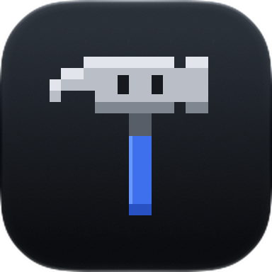
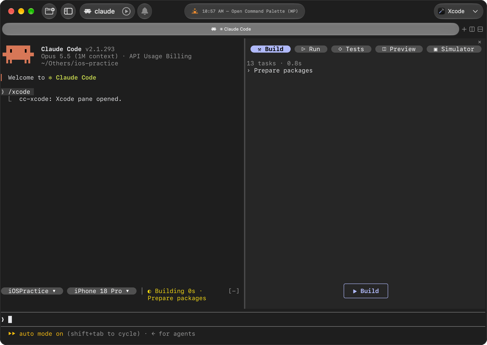

<p align="center">
  
</p>

<h1 align="center">cc-xcode</h1>

Xcode inside Claude Code, built as a [Claude Code mod](https://claude.dev/blog/getting-started-with-claude-code-mods/) over Xcode's headless MCP server: one side panel with **Build · Run · Tests · Preview · Simulator**, and a scheme and destination band above the prompt.

It picks up Claude's own Xcode tool calls too. When Claude builds, runs tests, launches the app or renders a preview, the result appears in the panel.



Based on [xcode-mods](https://github.com/artemnovichkov/xcode-mods) by Artem Novichkov (MIT).

## What it adds

| | |
| --- | --- |
| **Band** | Above the prompt: scheme and destination pills (click one to pick from its choices), what runs now or the last result, and error, warning and failed-test counters that open the matching tab |
| **Build** | Live progress, then errors and warnings. Click a file to open that line in Xcode. **Fix with Claude** sends the issues to Claude |
| **Run** | Build and run on the destination, with the app's stdout and OSLog streaming in. **Errors only**, **Clear**, **Ask Claude** |
| **Tests** | Grouped by target and suite, failures first with their messages. Click a test to run only it. **Failed** reruns the failures |
| **Preview** | Search the project's `#Preview` files and render one. Keeps the last 10 snapshots and re-renders after Claude edits a previewed file |
| **Simulator** | The booted simulator, about one frame a second. Click to tap, drag to swipe, type to send text, **⌂ Home**, **Open Device Hub** |
| **Toasts** | When a build, test run or launch ends, whoever started it |

## Requirements

- Xcode 27 or later, with its MCP server in headless mode
- Claude Code 2.1.293 or later, in a terminal with the kitty graphics protocol for images, such as [Ghostty](https://ghostty.org). The Claude desktop app works too
- A [Nerd Font](https://www.nerdfonts.com) for the rounded pills

## Setup

1. Turn on Xcode's headless MCP server (once):

   ```sh
   sudo xcrun mcp-server enable
   xcrun mcp-server status
   ```

2. Add the server to Claude Code. The mod expects it to be named `xcode`:

   ```sh
   claude mcp add --scope user xcode -- xcrun mcpbridge
   ```

3. Allow the mod's Xcode calls in `~/.claude/settings.json`, or every build and refresh asks for permission:

   ```json
   { "permissions": { "allow": ["mcp__xcode"] } }
   ```

4. Install it inside Claude Code. This repo is its own plugin marketplace:

   ```
   /plugin marketplace add abhi21git/cc-xcode
   /plugin install cc-xcode@cc-xcode
   ```

   Answer `y` to add the marketplace and choose the **user** scope so it loads in every session.

Open Claude Code in a folder with an `.xcodeproj` or `.xcworkspace` (up to 3 levels deep). The band appears above the prompt. In other folders the mod stays hidden and registers no commands.

Mods are an early-access Claude Code feature and their API can change between releases.

## Update

Inside Claude Code, then restart it:

```
/plugin marketplace update cc-xcode
/plugin update cc-xcode@cc-xcode
```

## Commands

| Command | What it does |
| --- | --- |
| `/xcode` | Open the panel |
| `/build` | Build the active scheme |
| `/run` | Build and run on the active destination, then stream the console |
| `/stop` | Stop the running app |
| `/tests [filter]` | Run all tests, or those whose `Target/identifier` contains the filter |
| `/preview @file.swift` | Render a `#Preview` in the Preview tab. Without an argument: `ContentView.swift`, or the first file with `#Preview` |

## Simulator input

Taps, swipes, typing and Home go through Xcode's DeviceInteraction tools. The session opens on the first touch and closes when you leave the tab. On a device with two screens (iPhone Duo) the primary one is mirrored.

## Troubleshooting

- **The band says `Xcode MCP server "xcode" not connected`.** Run `/mcp` and check the `xcode` server. Check that `xcrun mcp-server status` reports it as enabled.
- **Every action asks for permission.** Add the `mcp__xcode` allow rule from Setup.
- **The first preview takes a minute or more.** Xcode builds the preview host on the first render. Later renders are fast.
- **No image in the Preview or Simulator tab.** Your terminal has no kitty graphics protocol. The tab shows the PNG path instead.
- **Pills show as `?`.** Your terminal font is missing those glyphs. Install a Nerd Font.

## Development

```
hooks/register.tsx   entry: wires both modules
hooks/build.tsx      band and the panel (all five tabs)
hooks/canvas.tsx     SwiftUI preview rendering, /preview
hooks/pills.tsx      Client: the tab and band pills
hooks/button.tsx     Client: the big outlined buttons
hooks/touch.tsx      Client: taps and swipes over the simulator image
```

Run it from source with hot reload, then check and test it:

```sh
claude --plugin-dir .
claude plugin validate .
claude plugin test .
```

## License

MIT. See [LICENSE](./LICENSE). Original work © Artem Novichkov; modifications © Abhishek Maurya.
